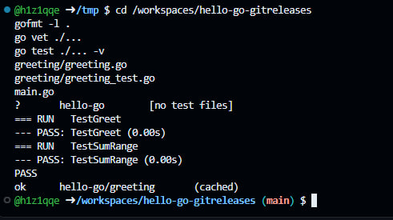
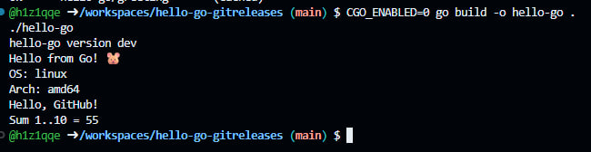
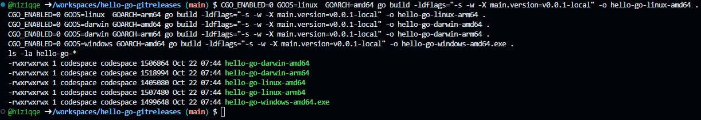
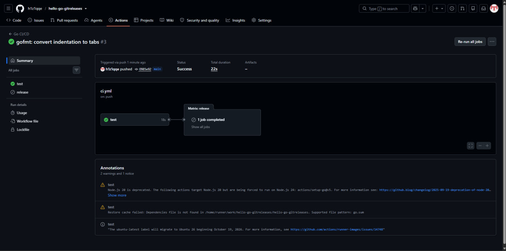
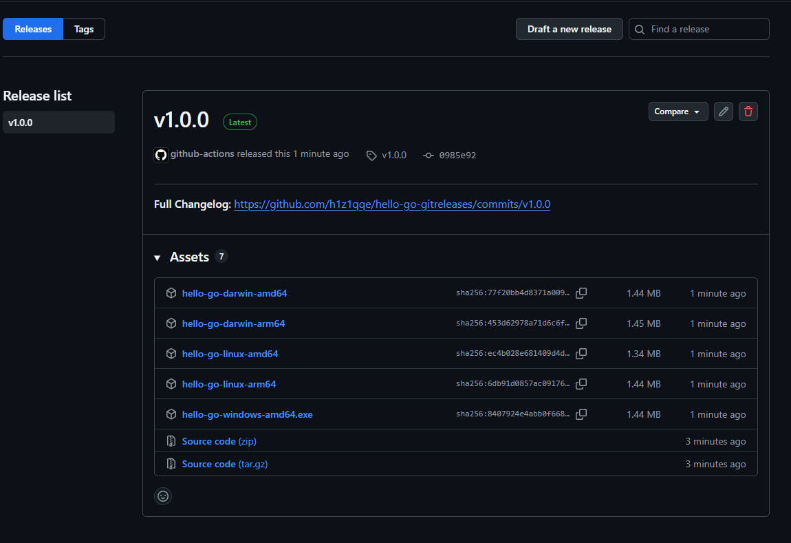
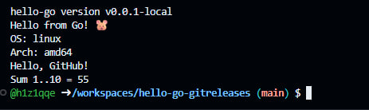

<div align="center">

# 📦 hello-go-gitreleases

**Лабораторная работа: CI/CD на Go — автоматическая сборка бинарников для 5 платформ и публикация в GitHub Releases**

[](https://github.com/h1z1qqe/hello-go-gitreleases/actions/workflows/ci.yml)
[](https://github.com/h1z1qqe/hello-go-gitreleases/releases)
[](https://codespaces.new/h1z1qqe/hello-go-gitreleases)

```bash
wget https://github.com/h1z1qqe/hello-go-gitreleases/releases/latest/download/hello-go-linux-amd64
chmod +x hello-go-linux-amd64 && ./hello-go-linux-amd64
```

*Вся работа — код, тесты, кросс-компиляция и релизы — выполнена в облаке, в GitHub Codespaces.*

</div>

---

## 📖 О проекте

Учебный проект, демонстрирующий второй способ доставки Go-приложений — **GitHub Releases**: при push тега `v*` GitHub Actions прогоняет тесты, собирает **статические бинарники под 5 платформ** и публикует их в Release. Для Go это самый естественный способ распространения: бинарник самодостаточен — ни Docker, ни JVM, ни интерпретатор конечному пользователю не нужны.

Версия приложения внедряется при компиляции через `-ldflags "-X main.version=..."`: локальная сборка знает себя как `dev`, сборка из релиза — как `v1.0.0`.

Ключевое отличие от [hello-go](https://github.com/h1z1qqe/hello-go) (прошлая лаба, публикация в GHCR):

| Аспект | GHCR (Docker) | Releases (бинарники) |
|---|---|---|
| **Триггер** | push в `main` | push тега `v*` |
| **Артефакт** | Docker-образ | статический бинарник |
| **Кросс-компиляция** | через buildx (multi-arch) | через `GOOS`/`GOARCH` |
| **Размер** | ~10–15 МБ | ~1.4–1.5 МБ |
| **Установка у пользователя** | Docker обязателен | ничего не нужно — просто исполняемый файл |
| **Версионирование** | `latest`, `sha-xxx` | `v1.0.0`, `v1.1.0` (semver) |
| **Кому** | DevOps, серверы | конечные пользователи |

Оба подхода дополняют друг друга: GHCR — для деплоя на серверы, Releases — для распространения среди пользователей.

## ✅ Проделанная работа

| # | Этап | Инструменты | Результат |
|---|---|---|---|
| 1 | Создание репозитория и запуск Codespace | GitHub, Codespaces | облачная среда разработки |
| 2 | Каркас проекта | `go mod` | пакет `greeting` + CLI с переменной `version` |
| 3 | Локальные проверки | `gofmt` / `go vet` / `go test` | 0 замечаний линтера, **2 PASS** |
| 4 | Локальная сборка и запуск | `go build` | `hello-go version dev` — версия пока не вшита |
| 5 | Кросс-компиляция | `GOOS`/`GOARCH` | 5 бинарников: linux/darwin/windows × amd64/arm64 |
| 6 | Публикация кода | `git push` в `main` | CI поймал проблему: отступы пробелами вместо табов |
| 7 | Фикс, подсказанный CI | `gofmt -w .` + push | зелёный прогон за 22s; job `release` пропущен (не тег) |
| 8 | Тег `v1.0.0` | `git tag` + `git push origin v1.0.0` | релизный прогон CI/CD |
| 9 | Матричная сборка | GitHub Actions `matrix` | 5 параллельных job'ов, версия вшита через `-ldflags -X` |
| 10 | Публикация релиза | `softprops/action-gh-release` | Release `v1.0.0` + 5 файлов (1.34–1.45 МБ) + автозаметки |
| 11 | Проверка бинарника | `wget` + `chmod` + запуск | `hello-go version v1.0.0` ✅ |

### 📊 Итоги прогонов

| Метрика | Значение |
|---|---|
| Коммит | [`0985e92`](https://github.com/h1z1qqe/hello-go-gitreleases/commit/0985e92) — push в `main` |
| CI-прогон (push в `main`) | ✅ **22s** — run «gofmt: convert indentation to tabs» (#3), job `release` пропущен (не тег) |
| Релизный прогон (тег `v1.0.0`) | ✅ `<ВРЕМЯ_РЕЛИЗА>`, `test` + 5 матричных job'ов |
| Платформы | linux/amd64, linux/arm64, darwin/amd64, darwin/arm64, windows/amd64 |
| Размер бинарников | 1.34–1.45 МБ каждый (linux-amd64 — 1.34 МБ) |
| Версия в бинарнике | `v1.0.0` (вшита через `-ldflags -X main.version=...`) |

## ⚙️ Как работает конвейер

Workflow состоит из двух job'ов с разными триггерами:

```text
push в main ───────► Job test: fmt → vet → test → build ✅
                     Job release: ПРОПУЩЕН (условие: refs/tags/v*)

push тега v1.0.0 ──► Job test: fmt → vet → test → build ✅
                     │
                     ▼
                     Job release — матрица, 5 параллельных сборок:
                     linux-amd64 · linux-arm64 · darwin-amd64
                     · darwin-arm64 · windows-amd64.exe
                     каждая: go build -ldflags "-X main.version=v1.0.0"
                     │
                     ▼
                     GitHub Release v1.0.0 + 5 бинарников + автозаметки
```

Два механизма, на которых всё держится:

- **Кросс-компиляция** — Go умеет собирать под любую платформу из коробки: достаточно переменных `GOOS`/`GOARCH` и `CGO_ENABLED=0` (без системных C-библиотек — бинарник полностью статический).
- **Внедрение версии** — флаг `-ldflags "-X main.version=v1.0.0"` записывает значение тега прямо в переменную `version` внутри бинарника при компиляции. Код не меняется, версия у каждого релиза своя.

## 🖼 Скриншоты

### 1. Тесты в Codespaces

`go test ./... -v` — `TestGreet` и `TestSumRange` проходят.



### 2. Локальная сборка и запуск

`go build -o hello-go . && ./hello-go` — обратите внимание на первую строку: `version dev` (значение по умолчанию из `main.go`).



### 3. Кросс-компиляция: 5 платформ

`GOOS=... GOARCH=... go build` для linux/darwin/windows — пять бинарников по 1.34–1.45 МБ, без единой виртуальной машины.



### 4. Первый CI-прогон: релиза нет

Прогон «gofmt: convert indentation to tabs» (#3): `test` зелёный за 18s, `release` пропущен — сработало условие `if: startsWith(github.ref, 'refs/tags/v')`. Релизы создаются только по тегам.



### 5. Релизный прогон по тегу v1.0.0

После `git push origin v1.0.0` матрица развернулась в 5 параллельных job'ов — по одному на платформу.


### 6. Релиз v1.0.0

Релиз опубликован ботом **github-actions**: автозаметки (Full Changelog), коммит `0985e92`, 5 бинарников в Assets — 1.34–1.45 МБ, у каждого sha256-дайджест.



### 7. Бинарник из релиза

`wget` → `chmod +x` → запуск: первая строка `hello-go version v1.0.0` — версия, вшитая при сборке на GitHub.



## 🚀 Установка

### Скачать из релиза (без Docker и без Go)

Ссылка `releases/latest/download/...` всегда отдаёт самый свежий релиз:

| Файл | Платформа |
|---|---|
| `hello-go-linux-amd64` | Linux x86-64 |
| `hello-go-linux-arm64` | Linux ARM (серверы, Raspberry Pi 4/5) |
| `hello-go-darwin-amd64` | macOS Intel |
| `hello-go-darwin-arm64` | macOS Apple Silicon (M1–M4) |
| `hello-go-windows-amd64.exe` | Windows x86-64 |

```bash
wget https://github.com/h1z1qqe/hello-go-gitreleases/releases/latest/download/hello-go-linux-amd64
chmod +x hello-go-linux-amd64
./hello-go-linux-amd64
```

Ожидаемый вывод:

```text
hello-go version v1.0.0
Hello from Go! 🐹
OS: linux
Arch: amd64
Hello, GitHub!
Sum 1..10 = 55
```

### Из исходников

```bash
git clone https://github.com/h1z1qqe/hello-go-gitreleases.git
cd hello-go-gitreleases
go run .          # version dev
go test ./... -v  # 2 PASS
```

## 🗂 Структура проекта

```text
hello-go-gitreleases/
├── .github/
│   └── workflows/
│       └── ci.yml            # два job'а: test (CI) + release (CD, по тегам v*)
├── docs/
│   └── screenshots/          # скриншоты для README
├── greeting/
│   ├── greeting.go           # Greet() и SumRange()
│   └── greeting_test.go      # unit-тесты
├── .gitignore                # игнорирует бинарники /hello-go, /hello-go-*
├── go.mod                    # module hello-go, go 1.23
└── main.go                   # CLI с переменной version (вшивается через -ldflags)
```

## 🧱 Технологии

| Технология | Как используется |
|---|---|
| **Go 1.23** | пакет `greeting` + CLI; статические бинарники `CGO_ENABLED=0` с `-ldflags "-s -w"` — по 1.34–1.45 МБ |
| **Cross-compilation** | `GOOS`/`GOARCH` из коробки: одна машина собирает под Linux, macOS и Windows |
| **Матричные сборки** | `strategy.matrix` — 5 параллельных job'ов, каждый со своей парой GOOS/GOARCH |
| **GitHub Releases** | `softprops/action-gh-release@v2` + `generate_release_notes` — релиз с файлами и автозаметками |
| **Внедрение версии** | `-ldflags "-X main.version=..."` — тег релиза вшивается в бинарник при компиляции |
| **Semver** | теги `v1.0.0`, `v1.1.0` — семантическое версионирование как триггер CD |
| **GitHub Codespaces** | облачная среда разработки — вся лаба выполнена в браузере |

## 🧪 Тесты

| Тест | Что проверяет |
|---|---|
| `TestGreet` | `Greet("Docker")` → `"Hello, Docker!"` |
| `TestSumRange` | `SumRange(1, 10)` → `55` |

## 🔗 Полезные ссылки

- [Репозиторий](https://github.com/h1z1qqe/hello-go-gitreleases) — исходный код
- [Workflow «Go CI/CD»](https://github.com/h1z1qqe/hello-go-gitreleases/actions/workflows/ci.yml) — история запусков
- [Релизы](https://github.com/h1z1qqe/hello-go-gitreleases/releases) — v1.0.0 и следующие
